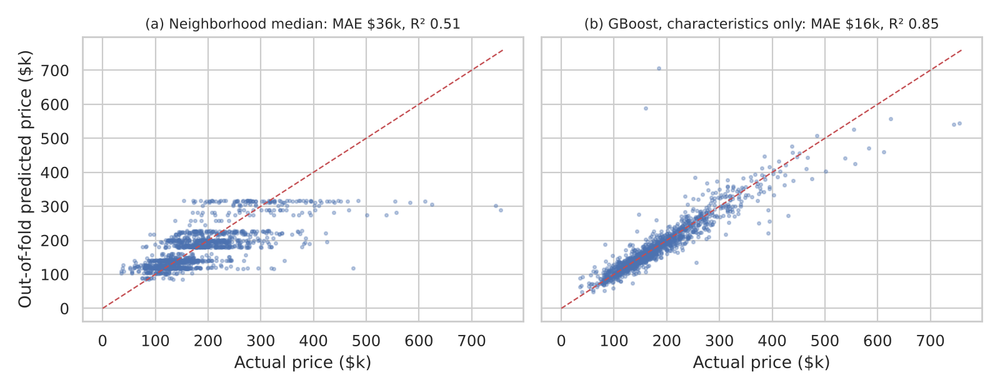
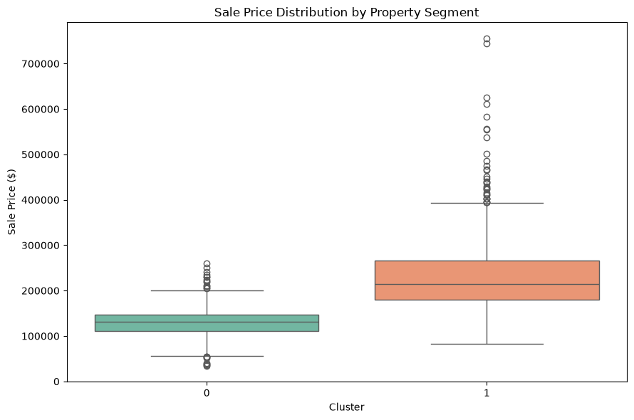
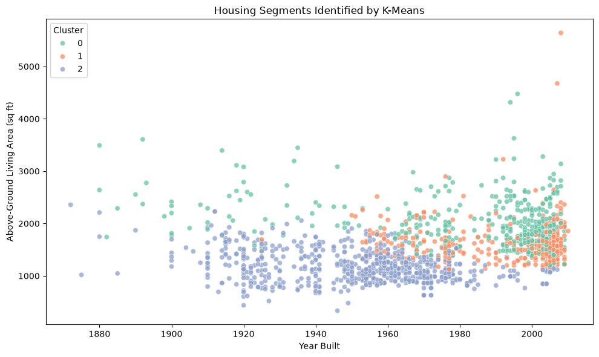

## Question 1: Can property characteristics predict sale prices more accurately than neighborhood-level price estimates?

### Approach
The baseline predicts each home's price as its **neighborhood median**. The floor predicts the overall median. We compare these with **Ridge regression** (interpretable, regularized for ~200 correlated columns) and **gradient boosting** (captures non-linearities and interactions such as quality × size). Both use **property characteristics only**: we removed location (`Neighborhood`, `MSZoning`, `Condition1/2`) so the test isolates characteristics against location, and removed sale-transaction fields (`SaleType`, `SaleCondition`, month/year sold), which are not known before a sale. A third model adds location back. NA in quality and type columns means "absent" (no garage, no pool, etc.). Ordinal quality codes map to 1–5 with absent = 0, and categorical NAs get their own level. All models fit log price, since the target is skewed (skew 1.9 to 0.1), and predictions are converted back to dollars for scoring. We evaluated with **5-fold CV** on `train.csv`. Neighborhood medians, imputation, scaling, encoding, and the Ridge penalty are all fitted inside each training fold. Gradient-boosting settings were left at standard defaults, so we did not tune on the reported folds. `test.csv` is unlabeled and unused.

### Evidence 
(mean ± SD over 5 folds; all 1,460 homes):

| Method | MAE | RMSE | R² |
|---|---|---|---|
| Overall median | \$55.7k ± 3.2k | \$81.3k ± 5.9k | −0.05 ± 0.02 |
| **Neighborhood median (baseline)** | **\$36.2k ± 1.4k** | **\$55.3k ± 3.2k** | **0.51 ± 0.03** |
| Ridge – characteristics | \$17.2k ± 2.7k | \$41.1k ± 30.7k | 0.58 ± 0.69 |
| **GBoost – characteristics** | **\$15.7k ± 1.5k** | **\$28.9k ± 9.3k** | **0.85 ± 0.12** |
| GBoost – characteristics + location | \$14.8k ± 1.7k | \$27.8k ± 10.0k | 0.86 ± 0.13 |

- Gradient boosting on characteristics cuts MAE by **57%** relative to the neighborhood median. It wins in **all 5 folds** (by 50–62%), is closer for **75%** of homes, and beats the baseline in **all 25 neighborhoods**. Median absolute error falls from 14.7% to 5.9% of price.
- Adding location helps only slightly (MAE \$15.7k → \$14.8k), so most of what the neighborhood median captures is already reflected in the house itself.
- Gains are largest in neighborhoods with mixed housing stock. Model gain correlates with within-neighborhood price variability (r = 0.43), e.g. StoneBr and Veenker improve by ~21 percentage points.
- *Ridge's large RMSE spread comes from one home.* Id 1299 is a 5,642 sq ft partial sale at \$160k, and Ridge predicts \$1.6M because linear models extrapolate. Excluding the 4 homes over 4,000 sq ft, as the dataset's author recommends, both Ridge and GBoost reach R² ≈ 0.92, compared with 0.52 for the baseline. The conclusion is unchanged.

### Limitations
(1) There is no independent test score. `test.csv` has no prices, so all estimates come from cross-validation on one dataset. (2) Very large or partial sales are badly mispredicted. Estimates should flag homes for review by a person, not price them automatically. (3) The folds are random, not time-based. We do not show performance on future sales, such as after the 2008 downturn; that would need a time-based split or newer data. (4) Gradient-boosting hyperparameters were not tuned, so its performance may be slightly understated. (5) The results are predictive associations in one market (Ames, 2006–2010), not causal effects. Q3 examines which features drive them.

## Question 2: Do homes form distinct property segments based on their physical characteristics?

### Approach

Real estate analysts and developers could use property segments to identify comparable homes and investigate potential investment or renovation opportunities. We applied K-means clustering to physical property characteristics, excluding `SalePrice` so that sale price did not determine cluster assignments. We compared two feature configurations: an initial set of 18 features and a reduced set of 15 features after removing correlated variables. We evaluated candidate cluster counts using silhouette scores and assessed sensitivity to feature selection using the adjusted Rand index (ARI). We then interpreted the clusters using characteristics such as construction year, overall quality, and living area. Sale prices were reserved for post-clustering comparison.

### Evidence

The results suggest that homes do not form strongly separated groups, with silhouette scores ranging from approximately 0.14 to 0.23. The 18-feature configuration favored three clusters (silhouette = 0.220), identifying spacious, high-quality two-story homes (407 homes), newer, high-quality ranch-style homes (355), and older, smaller, lower-quality homes (698). However, after removing correlated features, the best solution was two clusters (silhouette = 0.227): older, modest homes (median construction year approximately 1952, overall quality 5.18, and living area 1,204 sq. ft.) and newer, larger, higher-quality homes (median construction year approximately 1991, overall quality 7.06, and living area 1,841 sq. ft.).

The ARI between the two feature configurations was 0.94 at \(k=2\), indicating strong agreement, compared with 0.62 at \(k=3\), indicating less consistent assignments. Together with the higher silhouette score, this suggests that the two-cluster solution is more robust to feature selection, while the three-cluster solution provides more detailed but less stable segments.

| 15 Features | 18 Features |
|:---:|:---:|
|  |  |

### Limitations

The low silhouette scores indicate substantial overlap between clusters, so the segments should be interpreted as approximate property profiles rather than distinct housing categories. The three-cluster solution was more sensitive to feature selection, particularly the inclusion of second-floor area, suggesting that correlated features influenced the segmentation. K-means also favors compact, roughly spherical clusters and can be sensitive to skewed variables such as lot area. Future work could test log transformations, alternative clustering methods such as hierarchical clustering or Gaussian mixture models, and categorical features such as house style or neighborhood. In practice, real estate analysts should use these segments alongside neighborhood and other property characteristics rather than as strict rules for selecting comparable homes.
