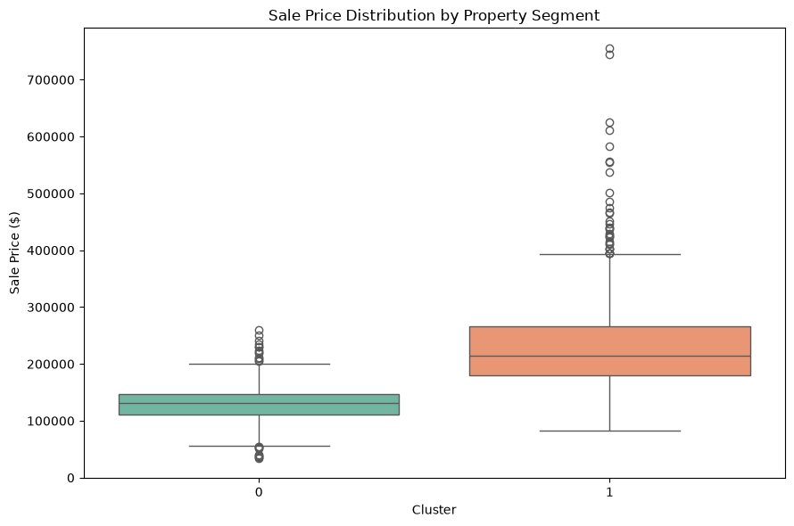
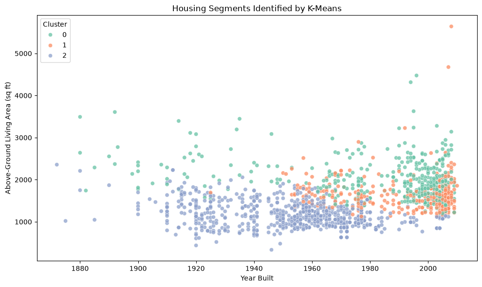

## Question 2: Do homes form distinct property segments based on their physical characteristics?

### Approach

Real estate analysts and developers could use property segments to identify comparable homes and investigate potential investment or renovation opportunities. We applied K-means clustering to physical property characteristics, excluding `SalePrice` so that sale price did not determine cluster assignments. We compared two feature configurations: an initial set of 18 features and a reduced set of 15 features after removing correlated variables. We evaluated candidate cluster counts using silhouette scores and assessed sensitivity to feature selection using the adjusted Rand index (ARI). We then interpreted the clusters using characteristics such as construction year, overall quality, and living area. Sale prices were reserved for post-clustering comparison.

### Evidence

The results suggest that homes do not form strongly separated groups, with silhouette scores ranging from approximately 0.14 to 0.23. The 18-feature configuration favored three clusters (silhouette = 0.220), identifying spacious, high-quality two-story homes (407 homes), newer, high-quality ranch-style homes (355), and older, smaller, lower-quality homes (698). However, after removing correlated features, the best solution was two clusters (silhouette = 0.227): older, modest homes (median construction year approximately 1952, overall quality 5.18, and living area 1,204 sq. ft.) and newer, larger, higher-quality homes (median construction year approximately 1991, overall quality 7.06, and living area 1,841 sq. ft.).

The ARI between the two feature configurations was 0.94 at \(k=2\), indicating strong agreement, compared with 0.62 at \(k=3\), indicating less consistent assignments. Together with the higher silhouette score, this suggests that the two-cluster solution is more robust to feature selection, while the three-cluster solution provides more detailed but less stable segments.

| 15 Features | 18 Features |
|:---:|:---:|
|  |  |

### Limitations

The low silhouette scores indicate substantial overlap between clusters, so the segments should be interpreted as approximate property profiles rather than distinct housing categories. The three-cluster solution was more sensitive to feature selection, particularly the inclusion of second-floor area, suggesting that correlated features influenced the segmentation. K-means also favors compact, roughly spherical clusters and can be sensitive to skewed variables such as lot area. Future work could test log transformations, alternative clustering methods such as hierarchical clustering or Gaussian mixture models, and categorical features such as house style or neighborhood. In practice, real estate analysts should use these segments alongside neighborhood and other property characteristics rather than as strict rules for selecting comparable homes.
